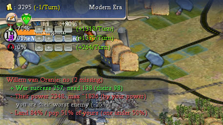
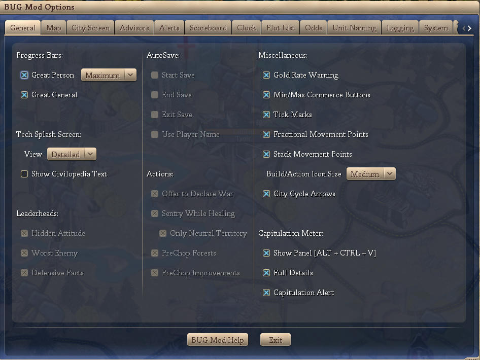

# Capitulation Meter

A small add-on for the [BUG Mod](https://forums.civfanatics.com/threads/download-bug-and-bat-here.274636/)
for Civilization IV: Beyond the Sword. While you are at war, it shows on the main screen how
close each AI is to capitulating to you, and which conditions are still missing.



Green `+` lines are conditions that are met, red `-` lines are still missing.

> **Status:** tested in a real game on the **Steam version** of Beyond the Sword 3.19 with
> BUG 4.4. See [Testing](#testing) for what was and was not covered.

This shows information the game normally hides, so it is arguably cheating. It only reads
game data and changes nothing. It turns itself off in network multiplayer.

## Install

You need **Beyond the Sword 3.19** and the **BUG Mod**
([download](https://forums.civfanatics.com/threads/download-bug-and-bat-here.274636/)).
Written for BUG 4.4. Install BUG first if you don't have it.

1. [Download the zip](https://github.com/luka-papez/Civ4BtsCapitulationMeter/archive/refs/heads/main.zip).
2. **Extract it** anywhere. Don't run it from inside the zip.
3. Close the game and double-click **`install.bat`**. If Windows shows a "protected your PC"
   warning, click *More info*, then *Run anyway*.
4. Start the game and load a save where you are **at war with an AI**. The panel appears at the
   top left. Existing saves work.

To **update**, do the same with the new zip. To **remove** it, double-click `uninstall.bat`.

The installer copies two files, adds one line to BUG's `Config\init.xml`, and saves the original
as `init.xml.bak`.

<details>
<summary><b>Install by hand</b></summary>

1. Open `Documents\My Games\Beyond the Sword`. It should already contain a `CustomAssets` folder
   with BUG in it.
2. Copy the `CustomAssets` folder from the zip there and let Windows merge the two. It adds two
   files and replaces none of BUG's.
3. Open `CustomAssets\Config\init.xml` in Notepad. Find this line:
   ```xml
   <load mod="MoreCiv4lerts"/>
   ```
   and add this one below it:
   ```xml
   <load mod="Capitulation Meter"/>
   ```
4. Save the file and start the game.

To remove it, delete that line.

</details>

### Not working?

| Problem | Fix |
|---|---|
| "BUG Mod was not found" | BUG is missing or installed elsewhere. If it is elsewhere, drag the folder that contains BUG's `Config` and `python` folders onto `install.bat`. |
| No panel in the game | It only shows while you are at war with an AI, on the main map. Press `Alt+Ctrl+V` in case it is hidden. |
| No BUG features either | BUG itself is not loading. Fix that first. |
| Playing another mod | Mods with `NoCustomAssets = 1` in their `.ini` ignore it. Mods with their own DLL may show wrong numbers, because they can change the rules. |
| Python error | Please open an issue with the text of the error. |

## Use

- The panel appears at the top left while you are at war with an AI.
- Every AI you are at war with is listed, closest to capitulating first. If they don't all fit,
  the rest shrink to one line each.
- `Alt+Ctrl+V` cycles full details, one line per enemy, and hidden.
- You get a message when an enemy becomes willing to capitulate.
- **To hide it or change settings**, open the BUG options (`Alt+Ctrl+O`), *General* tab, and look
  for *Capitulation Meter* below the *Misc* options. You can turn the panel, the full details and
  the alert on or off there. The alert works even when the panel is hidden.
- The panel position is in `Capitulation Meter.ini` in BUG's `UserSettings` folder.



The headline verdict is the game's own answer. The lines below it re-implement the game's
formula to explain the verdict. The "max" power is approximate, because the world average moves
as units are built and lost.

## How capitulation works

The rule is `CvTeamAI::AI_surrenderTrade` in the BTS DLL. There is no random roll. An enemy you
are at war with accepts when all of these hold:

| Condition | Rule |
|---|---|
| War success | Yours is at least theirs + 40. City capture +10, kill attacking +4, kill defending +3, capturing a unit such as a worker +1. Peace resets it. |
| Power vs world | Their power x 1.4 is at or below the average power per living team, adjusted for strong or hostile land neighbours. |
| Power vs you | Their power x 1.4 is at or below 2/3 of yours. Yours is scaled by relative war success (up to x2), and cut 25% if you are their worst enemy. |
| Size | Their land or their population is under 50% of yours. |
| Neighbours | No stronger land neighbour of theirs is at war with you but not with them. |
| Basics | You have Feudalism, neither of you is a vassal, and they are willing to talk. |

The 1.4 varies by leader: 1.9 for Genghis Khan and Sitting Bull, 1.2 for Gandhi, Mansa Musa,
Catherine and De Gaulle, for example.

The AI only offers capitulation by itself after more than 10 turns of war. You can propose it
as soon as they will talk.

## Testing

### In the real game

Tested on 2026-11-24 with the Steam version of Beyond the Sword 3.19 (build 128100), BUG 4.4
(build 2220) in `CustomAssets`, on Windows 10 with a 3840x2160 desktop. No other edition (GOG, retail) has
been tried.

Procedure, using a 1924 AD save with one war, against the Dutch:

| Step | Expected | Result |
|---|---|---|
| Start the game through Steam and load the save | Loads without Python errors | Pass |
| Look at the main map | Panel at the top left, covering no other controls | Pass |
| Press `Alt+Ctrl+V` three times | One line, hidden, full details | Pass |
| Open BUG options (`Alt+Ctrl+O`), *General* tab | Three Capitulation Meter checkboxes | Pass |
| Untick *Show Panel*, click *Exit* | Panel gone, `Show Panel = False` in the `.ini` | Pass |
| Press `Alt+Ctrl+V` | Panel is back, settings are on again | Pass |
| Contact the enemy from the scoreboard | He talks, and the panel does not say "Refuses to talk" | Pass |
| Open the trade table and hover *Capitulation* | Red, with a reason that fits the red lines in the panel | Pass: "We're doing fine on our own", the refusal for being too strong or too large |
| Open a city, then close it | Panel hides, then returns | Pass |

Not covered in a real game yet:

- An enemy that is willing to capitulate, and the alert for it
- Several wars at once
- The panel staying hidden after restarting the game

To repeat this with your own save, use the same steps. The trade table is the one that matters:
*Capitulation* must be selectable when the panel says "WILL CAPITULATE", and red when it says no.

### Offline tests

`tests\run.ps1` runs the module in the game's own `python24.dll` against a mocked game. It needs
the game installed and 32-bit PowerShell:

```powershell
& "$env:WINDIR\SysWOW64\WindowsPowerShell\v1.0\powershell.exe" -ExecutionPolicy Bypass -File .\tests\run.ps1
```

## License

GNU General Public License, version 3 or later. See [LICENSE](LICENSE). The BUG Mod, which this
extends, is also GPL version 3. No BUG or Firaxis files are included here.
